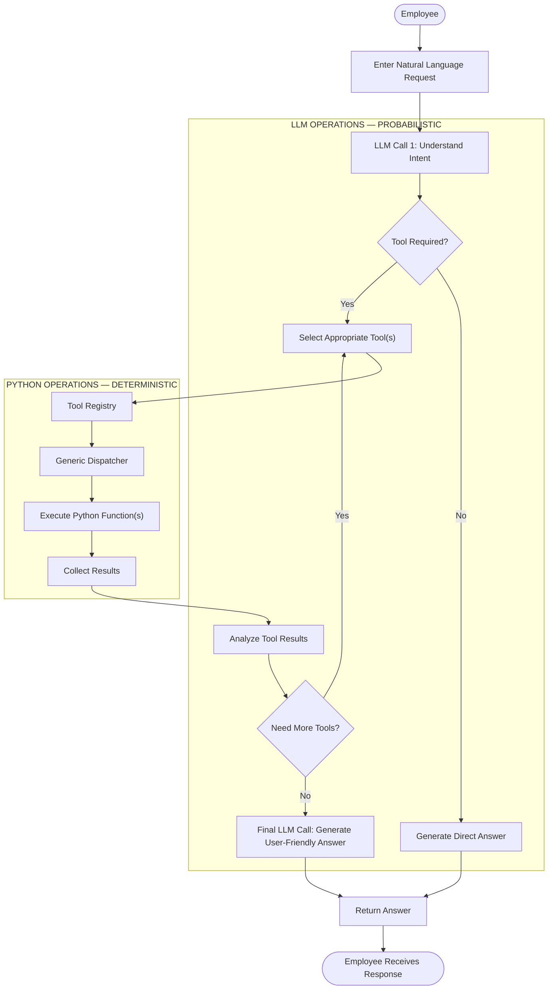

# AI-Powered Employee HR Assistant

**Agentic AI · Function Calling · OpenAI Responses API**

> Built for learning. All employee data is mock data.

An AI assistant that answers employee HR questions in natural language. It picks the right Python tool (or several), runs them, and turns the results into a friendly reply.

---

## 1. Business Use Case

An organization wants an AI-powered HR assistant that lets employees get HR information by asking in plain language.

Today, employees usually have to:

- Contact the HR department to check their salary.
- Log in to an HR portal to check their leave balance.
- Ask a manager for department information.
- Search internal systems for company holidays.
- Contact HR to check payroll status.
- Browse internal job postings and training opportunities.

### Proposed Solution

Employees ask questions in natural language, for example:

- *What is my salary this month?*
- *How many casual leaves do I have?*
- *Who is my reporting manager?*
- *Show me the available training courses.*
- *Tell me about my profile, leave balance, and payroll status.*

The assistant works out what the employee is asking, picks the right Python function or functions, gets the information, and writes a friendly answer.

---

## 2. Program Capabilities

The assistant has 10 tools:

| # | Tool | Example user request |
|---|---|---|
| 1 | `get_employee_info()` | Tell me about my employee profile. |
| 2 | `get_salary_info()` | What is my monthly salary? |
| 3 | `get_leave_balance()` | How many leaves do I have? |
| 4 | `get_attendance_info()` | Show my attendance this month. |
| 5 | `get_department_info()` | Tell me about my department. |
| 6 | `get_company_holidays()` | What are the upcoming holidays? |
| 7 | `get_manager_info()` | Who is my reporting manager? |
| 8 | `get_job_openings()` | What jobs are currently available? |
| 9 | `get_training_courses()` | Which training courses are available? |
| 10 | `get_payroll_status()` | Has my salary been processed? |

---

## 3. Example Interactions

### Example 1: Simple request (salary inquiry)

**Employee input:** "What is my salary this month?"

**LLM decision:** Call `get_salary_info(employee_id="E002")`.

**Python execution:**

```python
get_salary_info("E002")
```

**Tool result:**

```json
{
  "employee_id": "E002",
  "monthly_salary": 75000,
  "currency": "BDT",
  "payment_date": "2026-11-01"
}
```

**Final LLM response:**

> Your monthly salary is BDT 75,000, and it was paid on November 1, 2026. Let me know if you need any other HR information.

### Example 2: Simple request (leave balance)

**Employee input:** "How many casual leaves do I have remaining?"

**LLM decision:** Call `get_leave_balance(employee_id="E002")`.

**Python execution:**

```python
get_leave_balance("E002")
```

**Tool result:**

```json
{
  "annual_leave": 12,
  "sick_leave": 8,
  "casual_leave": 5
}
```

**Final LLM response:**

> You've got 5 casual leaves left. You also have 12 days of annual leave and 8 days of sick leave.

### Example 3: Complex request (multiple tools)

**Employee input:** "Tell me about my profile, my manager, and my leave balance."

**LLM decision:** The LLM picks three tools: `get_employee_info()`, `get_manager_info()`, and `get_leave_balance()`.

**Python execution:** The dispatcher runs all three functions and collects their results.

**Tool result:** The combined results for the employee profile, manager, and leave balances.

**Final LLM response:**

> Hi Jane! You're a Software Engineer in the Engineering department, and you joined us on March 15, 2022. You report to Mr. Rahman, our Engineering Manager. As for your leave, you've got 12 days of annual leave, 8 days of sick leave, and 5 days of casual leave left.

### Example 4: Unsupported request

**Employee input:** "Can you increase my salary by 20%?"

**LLM decision:** None of the 10 tools can approve or change a salary.

**Python execution:** No tool is run.

**Tool result:** None.

**Final LLM response:**

> I can tell you your current salary, but I can't approve salary changes. Please talk to your HR department or manager about a salary revision.

---

## 4. How the Program Works Internally

The program combines **probabilistic** LLM steps with **deterministic** Python steps.



---

## 5. What Makes This an Agentic AI Application?

A conventional chatbot usually depends on predefined intents and hand-written routing rules, such as checking whether a message contains the word "salary" or "leave."

This assistant uses the LLM to understand the request and choose the right tool instead. Phrases like *"What's my pay?"*, *"How much do I earn monthly?"*, *"Tell me my compensation,"* or *"Can I see my salary details?"* can all lead to the same tool without separate keyword rules.

> **Important distinction:** This is a tool-using AI agent with a fixed set of capabilities. It is not a fully autonomous enterprise agent.

---

## 6. Scope and Assumptions

- The 10 Python functions use mock employee data.
- The LLM chooses tools based on the natural-language request.
- Python runs the business functions.
- The LLM writes the final response.
- The agent can run several tools for a single request.
- The employee ID comes from the session, not from the user's message. The agent overrides any `employee_id` the model passes, so a user can't ask for someone else's records.

> **Production consideration:** In a real company, the functions would connect to HR databases or APIs, enforce authentication and authorization, validate tool arguments, and make sure sensitive data is only visible to authorized employees.

---

## 7. Code

The full implementation is in [`main.py`](main.py). It has four parts:

| Part | What it does |
|---|---|
| Mock data | Dictionaries for employees, salaries, leave, attendance, departments, and more |
| Tools | 10 plain Python functions plus their JSON schemas (`available_tools`) |
| Registry and dispatcher | `tool_registry` maps tool names to functions. `execute_tool()` runs them. |
| Agent loop | `run_agent()` alternates between the LLM and Python until the model gives its final answer |

The core of the agent loop (simplified):

```python
response = client.responses.create(
    model=MODEL, instructions=instructions,
    input=user_request, tools=available_tools,
)

while True:
    function_calls = [item for item in response.output if item.type == "function_call"]

    if not function_calls:                      # No more tools needed, so return the answer
        return response.output_text

    tool_outputs = []
    for call in function_calls:                 # Python runs each tool the LLM selected
        arguments = json.loads(call.arguments)
        if "employee_id" in arguments:          # Use the session's employee ID
            arguments["employee_id"] = employee_id
        result = execute_tool(call.name, arguments)
        tool_outputs.append({
            "type": "function_call_output",
            "call_id": call.call_id,
            "output": json.dumps(result),
        })

    response = client.responses.create(         # Send the results back to the LLM
        model=MODEL, instructions=instructions,
        previous_response_id=response.id,
        input=tool_outputs, tools=available_tools,
    )
```

---

## Setup and Run

### Prerequisites

- Python 3.9+
- An OpenAI API key

### 1. Go to the project folder

```bash
cd single-agent/hr-assistant-tool-calling
```

### 2. (Optional, recommended) Create and activate a virtual environment

Keeps this project's packages separate from your other Python projects.

```bash
python -m venv .venv
```

Windows (PowerShell):

```powershell
.venv\Scripts\Activate.ps1
```

macOS / Linux:

```bash
source .venv/bin/activate
```

### 3. Install dependencies

```bash
pip install -r requirements.txt
```

### 4. Set your OpenAI API key

Windows (PowerShell):

```powershell
$env:OPENAI_API_KEY = "your-api-key"
```

macOS / Linux:

```bash
export OPENAI_API_KEY="your-api-key"
```

### 5. Run the assistant

```bash
python main.py
```

The script runs one sample request for employee `E002` and prints the assistant's answer. To try other questions, change `user_request` in `main()`. To act as a different employee, change `authenticated_employee_id` to `E001`.
